# 🚀 Automated Python Flask Application Deployment on AWS EC2 Using Jenkins Pipeline & GitHub Webhooks

## 📌 Project Overview

This project demonstrates an automated **CI/CD pipeline** for deploying a Python Flask web application on an AWS EC2 instance using **Jenkins Pipeline and GitHub Webhooks**.

Whenever a developer pushes code changes to the GitHub repository, a GitHub Webhook triggers Jenkins automatically. Jenkins checks out the source code, sets up the Python environment, installs dependencies, validates the application, and deploys the application to AWS EC2 using SSH and SCP.

The Flask application runs using **Gunicorn** on port `5000`.

## 🏗️ Architecture

**Deployment Workflow:**

Developer → GitHub Repository → GitHub Webhook → Jenkins Pipeline → Application Validation → SSH/SCP Deployment → AWS EC2 → Gunicorn → Flask Web Application

### Architecture Overview


## 🛠️ Technologies Used

* **Python & Flask** – Application
* **AWS EC2 & Linux** – Hosting
* **Jenkins** – CI/CD
* **Git & GitHub** – Version control
* **GitHub Webhooks** – Automatic builds
* **SSH, SCP & Gunicorn** – Deployment


## Prerequisites

Before configuring the project, make sure you have:

-   A GitHub account and this repository.
-   A running Jenkins server with Git and Pipeline support.
-   An AWS EC2 instance running Amazon Linux.
-   SSH access from the Jenkins server to the EC2 instance.
-   A Jenkins SSH credential configured for the target instance.
-   Security group rules that allow the required SSH traffic.
-   Port `5000` allowed for application testing if you intend to access
    the app directly from your browser. Restrict this rule to trusted IP
    addresses where possible.

## How the CI/CD Workflow Works

1.  A developer commits and pushes an application change to GitHub.
2.  GitHub sends a push event to the configured Jenkins webhook
    endpoint.
3.  Jenkins starts the pipeline.
4.  Jenkins checks out the source code and prepares the Python
    environment.
5.  The pipeline installs the application dependencies and validates the
    Flask application.
6.  Jenkins transfers the application files to the EC2 instance using
    SSH/SCP.
7.  The remote deployment step prepares the Python environment and
    starts Gunicorn.
8.  Jenkins runs a health check against the application endpoint to
    verify that it responds.

GitHub Webhooks automatically notify Jenkins when code changes are pushed to the repository.


## Jenkins Setup

1.  Open Jenkins and create or configure a Pipeline job named
    `python-with-webhook`.

    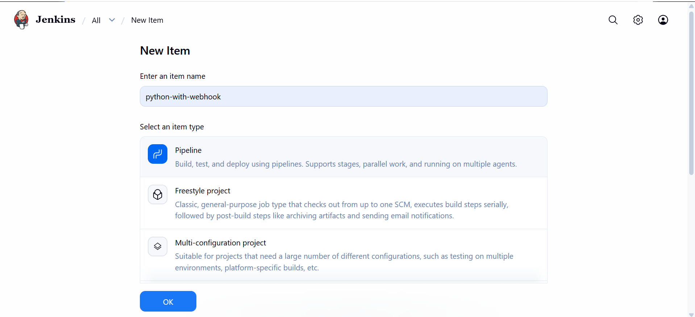

2.  Under **Build Triggers**, enable **GitHub hook trigger for GITScm
    polling**.
    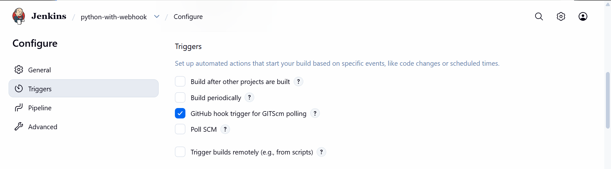

3.  Configure the job to use the GitHub repository and the `main`
    branch.
    
    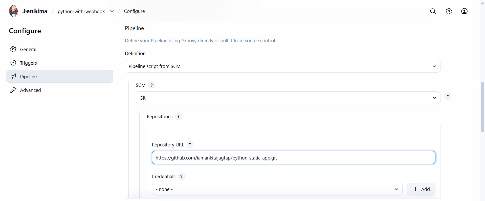

4.  Set the pipeline definition to use the `Jenkinsfile` from source
    control.
    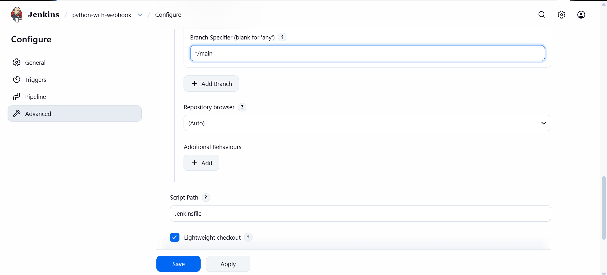

5.  Add an SSH credential for the target EC2 instance with the ID
    expected by the pipeline, such as `ec2-target-key`.
6.  Save the job and run a manual build first to verify the
    configuration.

The Jenkins service must be able to reach GitHub and connect to the
target EC2 instance over SSH.

## GitHub Webhook Setup

1.  Open the GitHub repository.

2.  Go to **Settings → Webhooks → Add webhook**.

3.  Set the payload URL to:

    ``` text
    http://<JENKINS-PUBLIC-IP>:8080/github-webhook/
    ```

4.  Save the webhook.
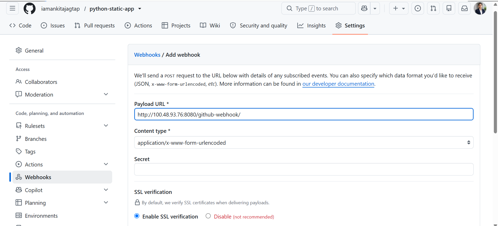
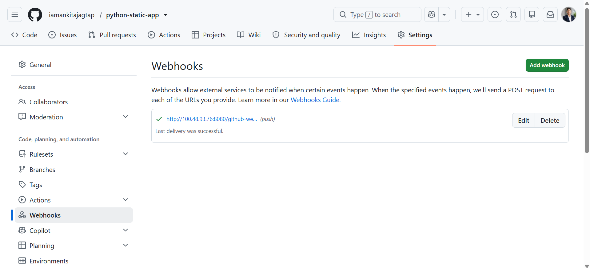


## Deployment Steps

### 1. Update the application

Make the required change to the Flask application or template. Commit
only the file you intend to change. For example, to commit only the
template:

``` powershell
git add templates/index.html
git commit -m "Update index.html"
git push origin main
```
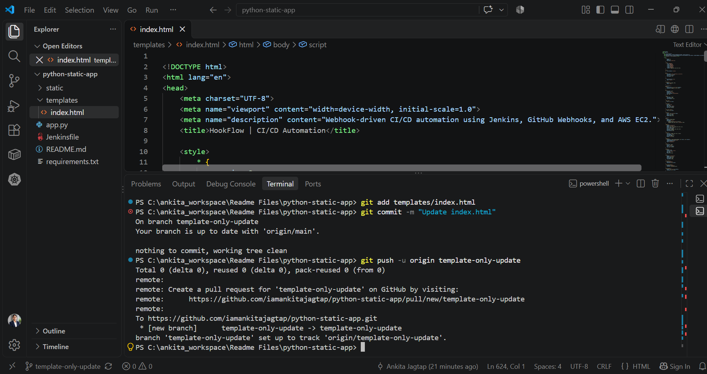


### 2. Review the pipeline

Open the Jenkins job and inspect **Console Output**. Confirm that
checkout, dependency installation, validation, file transfer, remote
setup, and health-check stages complete successfully.

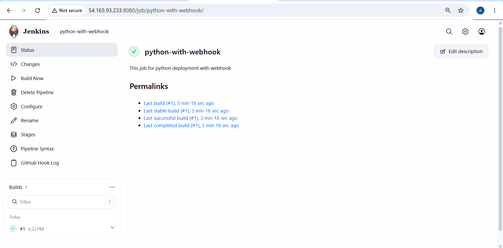
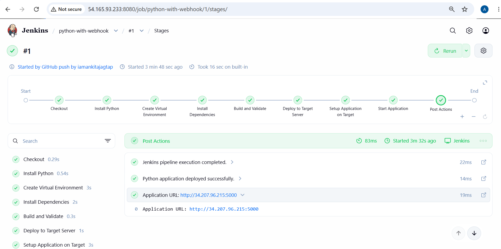
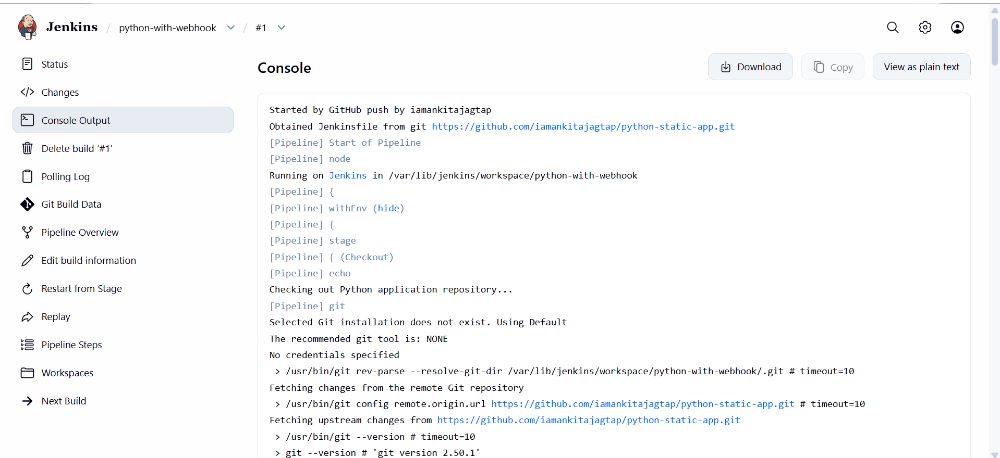

### 3. Test the application

If port `5000` is reachable from your machine, open:

``` text
http://<target-server-ip>:5000/
```
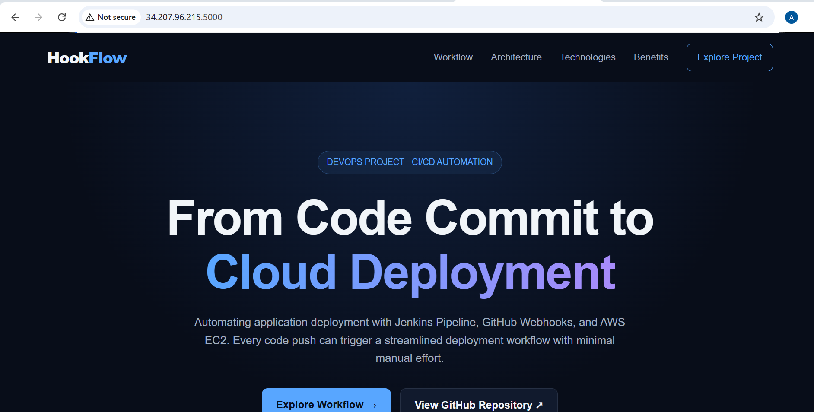


## 📚 Key Learnings

Through this project, I gained practical experience with:

- Building CI/CD pipelines using Jenkins Declarative Pipeline.
- Integrating GitHub Webhooks with Jenkins.
- Automating deployments to AWS EC2.
- Managing Linux servers and Python virtual environments.
- Using SSH and SCP for remote deployments.
- Running Flask applications with Gunicorn.
- Performing application health checks with `curl`.
- Troubleshooting Git, Jenkins, and deployment issues.

## 🎯 Project Outcome

This project demonstrates how GitHub Webhooks can automatically trigger Jenkins pipelines to deploy a Python Flask application to AWS EC2.

It reduces manual deployment steps and provides hands-on experience with CI/CD automation, cloud hosting, secure remote deployment, and application validation.


## 👩‍💻 Author

**Ankita Jagtap**

Cloud & DevOps Engineer


